# Destination Opening Programme: schedule intelligence

**One decision-ready view of programme delivery: Primavera P6 schedules (XER) reconciled into a web dashboard,
a Power BI model and executive PowerPoint packs, with schedule-quality and reconciliation controls built in.**

**Live dashboard:** https://schedule-intelligence.github.io/destination-opening-programme/

> Fictional programme, fictional data. Schedules are produced by a custom CPM engine that follows Primavera P6
> conventions and are exported in genuine P6 XER format. No P6 licence was used (see [Transparency](#transparency)).

## Purpose and how it was built

<!-- CANDIDATE TO CONFIRM WORDING -->
This repository was built as a working demonstration for a planning & reporting and operational-readiness role.
The scheduling logic, the storyline, the controls design and the governance content reflect the author's
professional practice in programme planning and controls. The implementation was AI-assisted. Everything is
reproducible from one command (`python -m dop run --all`) and verified by the automated test suite. The design is
in [DESIGN.md](DESIGN.md) and the planning decisions behind it are in [DESIGN_DECISIONS.md](DESIGN_DECISIONS.md).
<!-- /CANDIDATE TO CONFIRM WORDING -->

---

## The answer at 29-Oct-2026

**Day 1 Opening is forecast for 21-Oct-2027, 7 working days beyond the 14-Oct-2027 target.** The longest path runs
through the Dune Arena: MEP second fix, then fire-strategy smoke-extract works, front-of-house fit-out and the
occupancy certificate. Approving recovery option **A (zone-based completion) by 12-Nov-2026 and B (phased handover
with early operator access) by 26-Nov-2026** returns the forecast to 06-Oct-2027 with **+8 working days of float**.
Every number on the
dashboard, in the packs and in the CSVs reconciles to the source XER: 40 controls per data date, and the pipeline
fails if any control breaks.

## Screenshots

| Executive summary | Critical path & look-ahead |
|---|---|
| 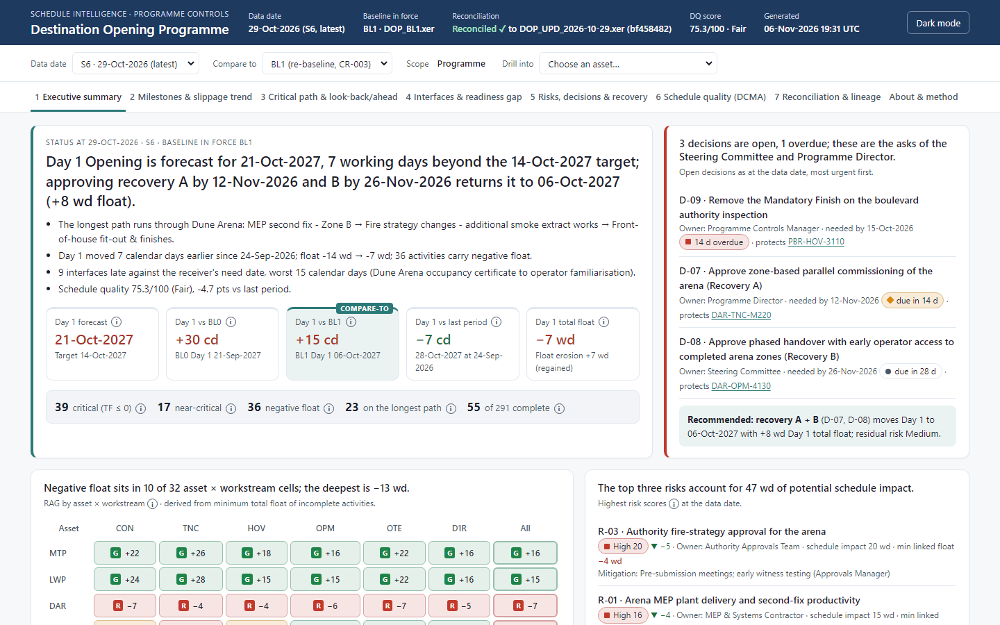 | 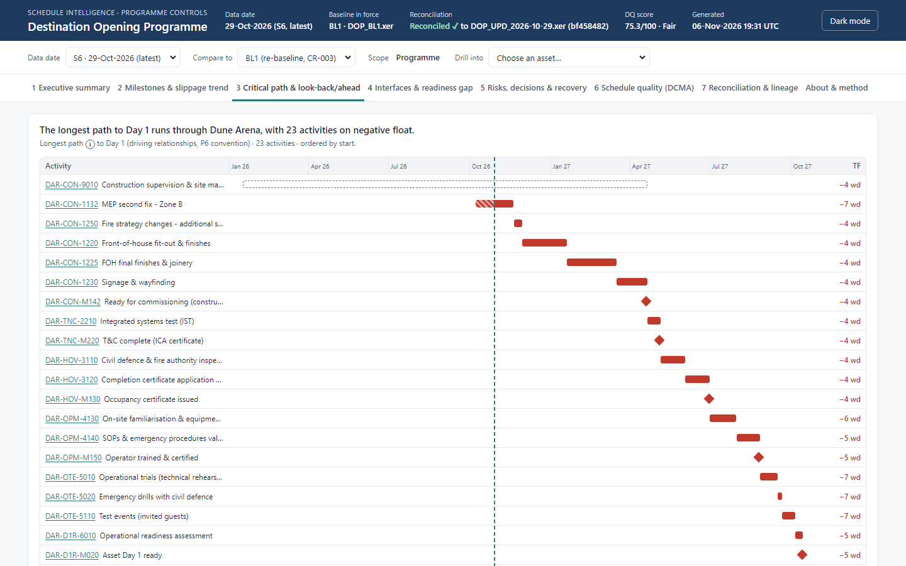 |
| **Interfaces & readiness gap** | **Schedule quality (DCMA)** |
| 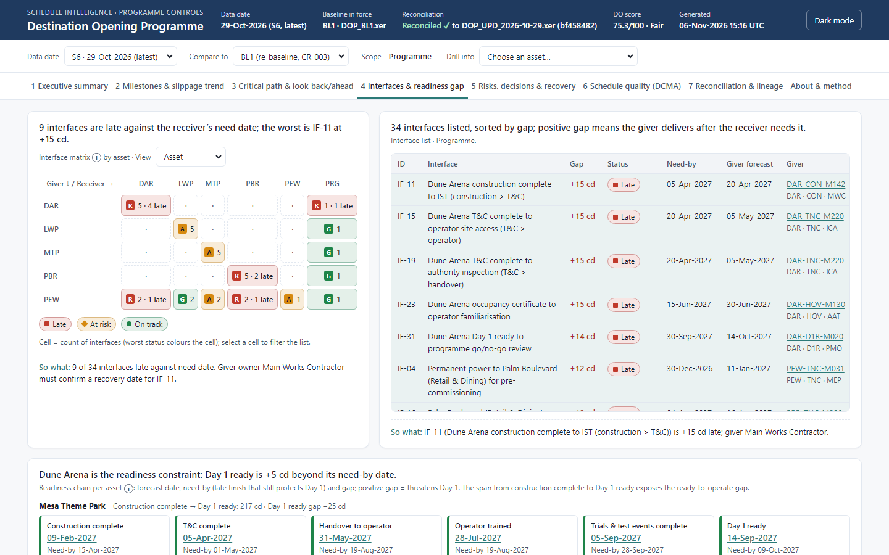 | 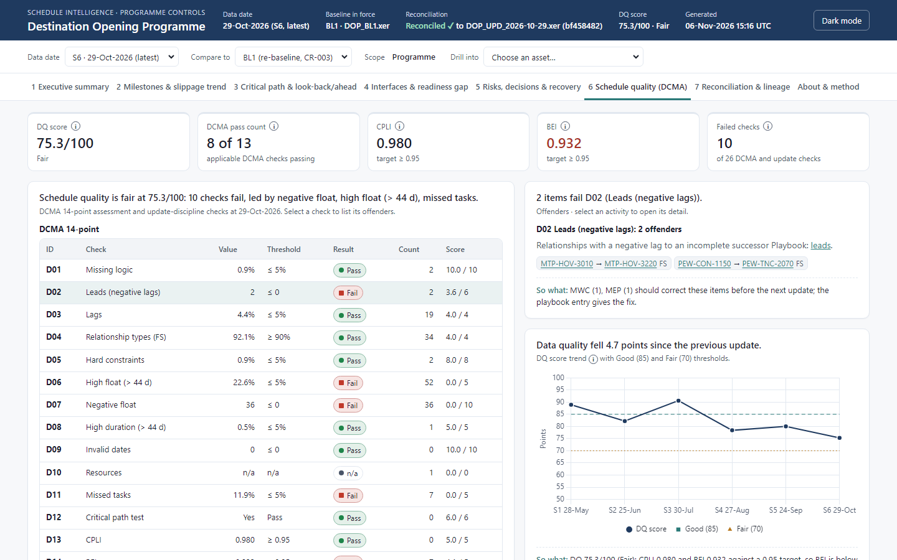 |
| **Reconciliation & lineage** | **Dark mode** |
| 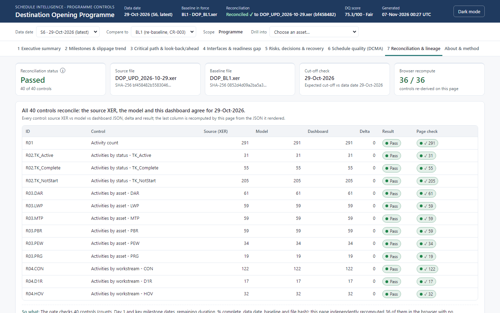 | 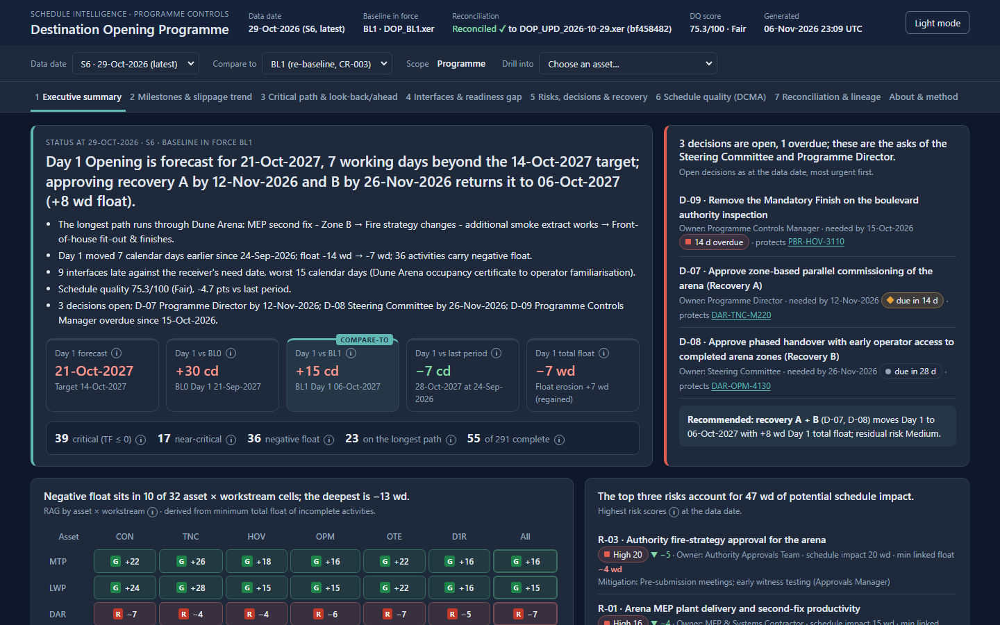 |

Mobile (360 px): [exec_mobile.png](docs/screenshots/exec_mobile.png) · other tabs: [milestones](docs/screenshots/tab2_milestones.png), [risks & recovery](docs/screenshots/tab5_risks.png), [about & method](docs/screenshots/tab8_about.png)

## Executive packs

Generated from the same reconciled JSON as the dashboard (`python -m dop run --all`). Download the
[monthly steering-committee pack](docs/downloads/DOP_monthly_pack_2026-10-29.pptx) (15 slides) or the
[fortnightly flash](docs/downloads/DOP_fortnightly_flash_2026-10-29.pptx) (6 slides).

| Cover | Executive summary |
|---|---|
| 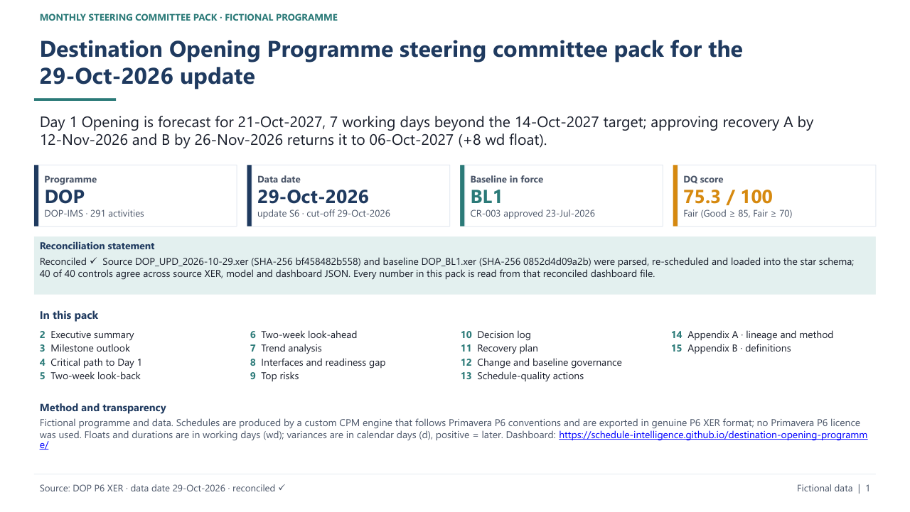 | 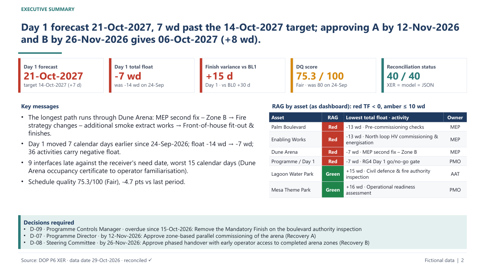 |
| The answer in one sentence, data date, baseline in force, DQ score, the reconciliation statement and the contents. | Day 1 against the target, BL1 and last period, RAG by asset, and the three decisions required with owners and dates. |
| **Trend analysis** | **Interfaces and readiness gap** |
| 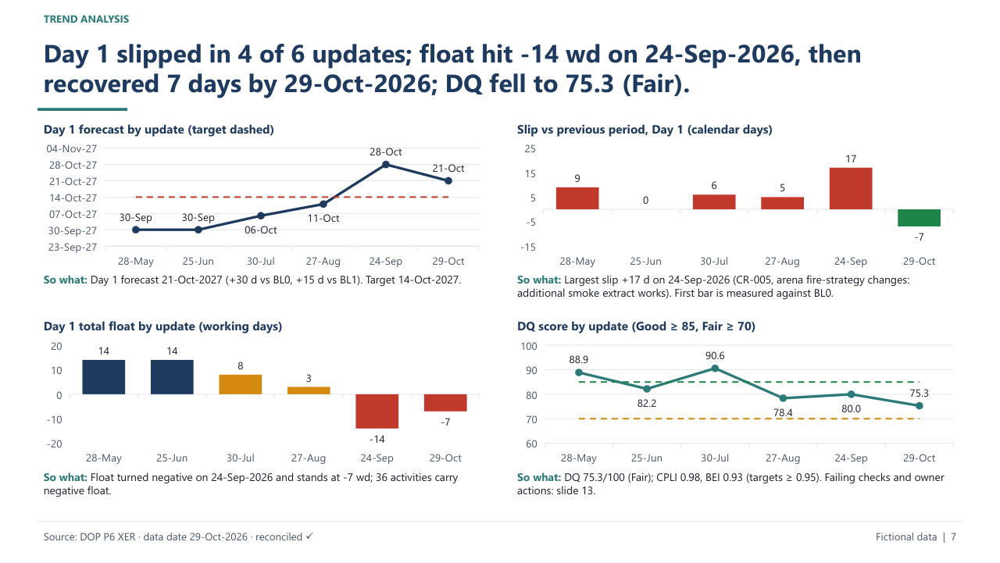 | 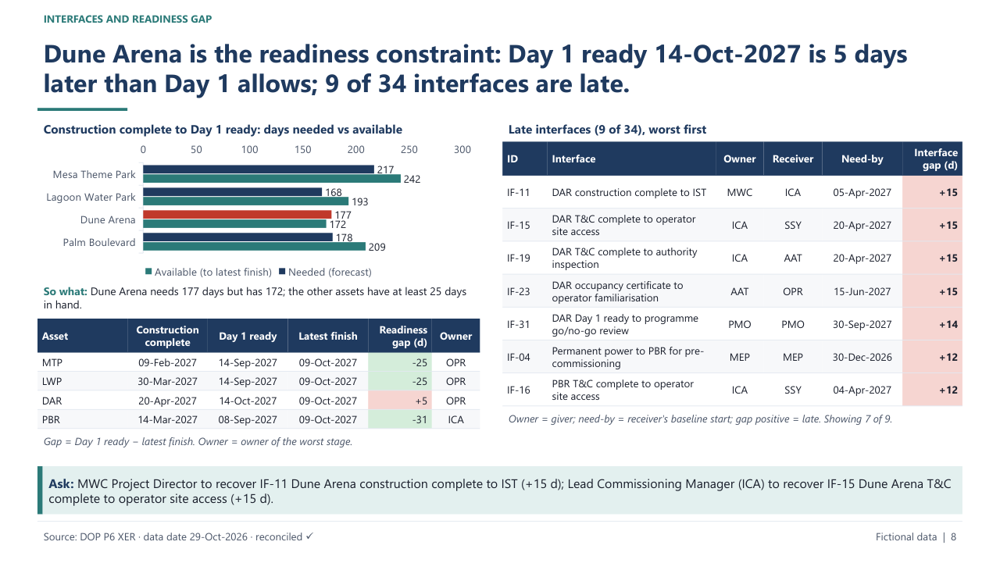 |
| Day 1 forecast, slip per period, float eroding into negative territory, and the DQ score across six updates. | Construction complete to Day 1 ready for each asset, and the late handovers between owners, worst first. |
| **Recovery plan** | **Schedule-quality actions** |
| 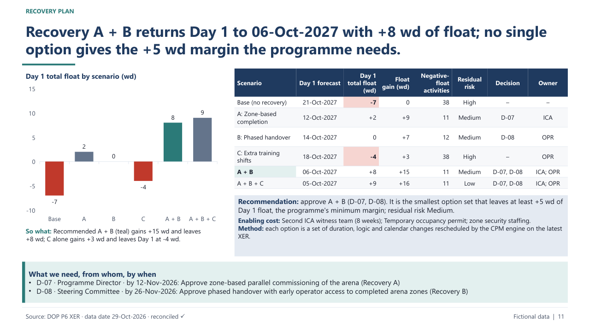 | 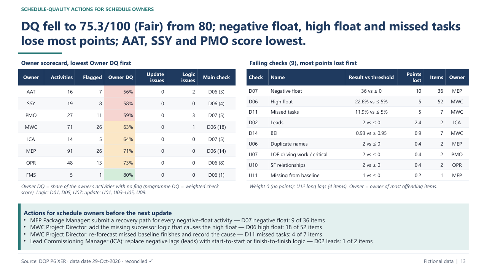 |
| Every option rescheduled by the CPM engine; A + B is the smallest set that keeps the +5 wd margin. | Owner scorecard, failing DCMA and update-discipline checks, and the action each owner takes before the next update. |
| **Fortnightly flash** | |
| 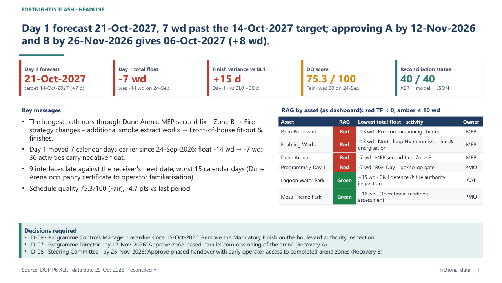 | |
| The same headline, tiles and decisions for the in-between cycle, in six slides. | |

Slide previews are rendered from the generated `.pptx` files with LibreOffice (`scripts/render_pptx_previews.py`).

## Two-minute tour

1. **Executive Summary (30 s).** Read the headline sentence: status, risk and the decision needed. Then look at
   the Day 1 tiles against BL0, BL1 and last period, the RAG matrix (asset × workstream) and the two open decisions.
2. **Change the data date (20 s).** Step from 28-May to 29-Oct-2026 and watch float erode on the arena path: BL1 at
   30-Jul, negative float from 24-Sep, partial recovery in October.
3. **Critical Path (20 s).** The longest path to Day 1 as a Gantt, near-critical work and the two-week look-back and
   look-ahead.
4. **Interfaces & Readiness Gap (20 s).** Per asset: construction complete → T&C → handover → operator trained →
   trials → Day 1 ready. This is the gap between "built" and "ready to operate".
5. **Risks, Decisions & Recovery (15 s).** Three recovery options, rescheduled by the CPM engine; A + B is recommended.
6. **Schedule Quality (10 s).** The DCMA 14-point checks plus update-discipline checks. Click a failing check to see
   the offending activities and their owners.
7. **Reconciliation (5 s).** Every control shows its source XER, model and dashboard values. This is why the view can be trusted.

Downloads: [monthly steering-committee pack](docs/downloads/DOP_monthly_pack_2026-10-29.pptx) ·
[fortnightly flash](docs/downloads/DOP_fortnightly_flash_2026-10-29.pptx) ·
[Excel controls workbook](docs/downloads/DOP_controls_2026-10-29.xlsx)

## Problem → solution

| Pain on giga-programmes | What this repo does |
|---|---|
| No single trusted view: each workstream reports its own dates | One integrated master schedule from construction to Day 1 (291 activities, 39 milestones, 34 interfaces), one pipeline, one JSON feeding web, Power BI and PPT |
| Dashboards do not reconcile with the approved P6 schedule | A reconciliation gate (XER = model = dashboard) on counts, dates, durations, % complete, critical count, data date, baseline and file hash. A non-zero exit blocks publication |
| Weak schedule quality | DCMA 14-point plus 12 update-discipline checks, a weighted DQ score, an owner scorecard and a [schedule owner playbook](governance/SCHEDULE_OWNER_PLAYBOOK.md) |
| Manual, slow reporting | `python -m dop run --all` produces the XER files, 22 CSV tables, the JSON, 6 Excel workbooks and both packs in under a minute |
| Construction complete ≠ ready to operate | A readiness chain per asset, interface need-by dates and operator mobilisation, trials and Day 1 readiness in the same logic network |

## Architecture

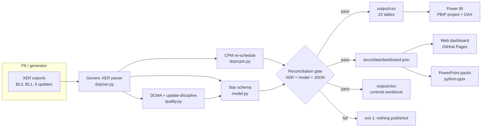

## Repo layout

```
dop/                  CPM engine, calendars, fictional programme, storyline, simulator, XER writer/parser
dop/pipeline/         loader, quality (DCMA), star schema, narrative, reconciliation gate, exports, Excel
dop/pptx_gen.py       monthly and fortnightly executive packs
data/xer/             DOP_BL0.xer, DOP_BL1.xer, DOP_UPD_<date>.xer x6 (genuine XER structure)
data/registers/       risks, decisions, changes, interfaces, recovery options, reporting calendar
data/truth/           injected-issue truth files used by the tests
output/csv|xlsx|pptx|reports/
docs/                 GitHub Pages site (index.html, data/dashboard.json, downloads/, screenshots/)
governance/           scheduling framework, reporting calendar, RACI, reporting standards, owner playbook
powerbi/              Power BI project DOP.pbip (semantic model + 7 report pages), DAX measures and theme
tests/                pytest: hand-calculated CPM networks, invariants, XER round trip, truth, gate, integrity, outputs
scripts/              dashboard verification (Playwright), DAX column check, confidentiality check
```

Design: [DESIGN.md](DESIGN.md) (programme, storyline, data model, engine conventions, checks, controls, outputs) ·
[DESIGN_DECISIONS.md](DESIGN_DECISIONS.md) (the planning decisions behind it).

## How to run

PowerShell (Windows):

```powershell
python -m venv .venv
.\.venv\Scripts\Activate.ps1
pip install -r requirements.txt
python -m dop run --all          # generate -> pipeline (gate) -> packs; prints elapsed time
python -m pytest -q              # under 2 minutes
# or simply: .\run_all.ps1
```

bash:

```bash
python3 -m venv .venv && source .venv/bin/activate
pip install -r requirements.txt
python -m dop run --all && python -m pytest -q      # or ./run_all.sh
```

Individual steps: `python -m dop generate`, `python -m dop pipeline [--near-critical 10]`,
`python -m dop pptx --data-date 2026-10-29 --pack monthly|fortnightly`,
`python -m dop pbip` (regenerates the Power BI project; not part of `run --all`).

Verification tools: `python scripts/verify_dashboard.py` (headless Chromium over every data date, compare mode and
tab), `python scripts/render_pptx_previews.py` (renders both packs with LibreOffice for visual review and refreshes
the slide previews), `python scripts/check_pbip.py` (validates the Power BI project offline against the published
schemas and the model) and `python scripts/check_confidentiality.py`.

## Outputs

| Output | Where |
|---|---|
| P6 XER files (2 baselines + 6 updates) | `data/xer/` |
| Star schema (7 dims, 15 facts) for Power BI | `output/csv/` · [POWERBI.md](POWERBI.md) · [DATA_DICTIONARY.md](DATA_DICTIONARY.md) |
| Power BI project: semantic model, 96 measures, 7 report pages + drill-through | `powerbi/DOP.pbip` · [README_PBIP.md](powerbi/README_PBIP.md) |
| Dashboard data (self-describing, reconciled) | `docs/data/dashboard.json` · [schema](docs/data/README.md) |
| Reconciliation reports | `output/reports/reconciliation_<date>.md` |
| Excel controls workbook per data date | `output/xlsx/DOP_controls_<date>.xlsx` |
| Monthly and fortnightly PowerPoint packs | `output/pptx/` and `docs/downloads/` |

## What this demonstrates

| JD requirement | Where it is demonstrated |
|---|---|
| A. Integrated master schedule from construction to Day 1; EPS, WBS, codes, calendars, logic, milestones, constraints, baselines | `dop/programme.py`, `dop/storyline.py`, `data/xer/*.xer`; [SCHEDULING_FRAMEWORK.md](governance/SCHEDULING_FRAMEWORK.md) |
| A. Validate schedule quality: logic, open ends, constraints, lags, calendars, float paths, critical and near-critical | `dop/pipeline/quality.py` (DCMA 14 + update discipline), Schedule Quality tab, owner scorecard; tests prove every injected issue is caught with zero false positives |
| A. Update cycles, progress validation, variance, forecasting, scenario modelling, recovery planning | Six monthly updates; variance vs BL0 / BL1 / previous; milestone trend; recovery scenarios rescheduled by the CPM engine; Recovery tab and slide |
| A. Controls for ownership, change, data cut-off, status dates, approvals, baseline governance | Owner codes, change register, BL1 via CR-003, data-date control U08; [PLANNING_REPORTING_CALENDAR.md](governance/PLANNING_REPORTING_CALENDAR.md) |
| B. Power BI model from P6 exports; automated progress, milestone, critical path, float, variance, slippage, look-ahead, risk and dependency reporting | `output/csv/` star schema; Power BI project [`powerbi/DOP.pbip`](powerbi/README_PBIP.md) (semantic model, 96 DAX measures, 7 pages); [POWERBI.md](POWERBI.md); `powerbi/dop_theme.json` |
| B. Drill-down portfolio → programme → project → workstream → WBS → activity | Dashboard breadcrumb and activity drawer; Power BI field parameters |
| B. Data definitions and reconciliation controls aligned to the approved P6 schedule | [DATA_DICTIONARY.md](DATA_DICTIONARY.md); reconciliation gate (R01–R16); Reconciliation & Lineage tab; "Reconciled ✓" header |
| C. Consulting-quality packs: executive summary, milestone outlook, critical path, two-week look-back and look-ahead, trend, decision log, recovery plan, owners and asks | `dop/pptx_gen.py` monthly (15 slides) and fortnightly (6 slides) packs |
| Gap between delivery completion and operational readiness | Interfaces & Readiness Gap tab and slide; operator mobilisation, trials and Day 1 readiness in the same network |
| Standards, templates, RACI, reporting calendar, quality checks, governance routines | [`governance/`](governance/) |
| Coach schedule owners and reporting contributors | [SCHEDULE_OWNER_PLAYBOOK.md](governance/SCHEDULE_OWNER_PLAYBOOK.md); owner scorecard |
| Measures: traceable source data; outputs reconcile to P6; reduced manual effort and cycle time | Lineage footers and SHA-256 hashes; reconciliation gate; one-command pipeline with timing printed |
| Excel (advanced): reconciliations, quality checks, automation | `output/xlsx/DOP_controls_<date>.xlsx` (conditional formatting, frozen headers, filters) |

## Transparency

- **Synthetic data.** The programme, assets, owners, risks and decisions are invented. Nothing comes from a real project.
- **P6 XER format.** The files follow the real XER structure: an `ERMHDR` header and `%T/%F/%R/%E` records, with tables
  PROJECT, CALENDAR, PROJWBS, TASK, TASKPRED, ACTVTYPE, ACTVCODE and TASKACTV, P6 field names and enumerations
  (`TT_*`, `TK_*`, `CS_*`, `PR_*`), hours in `*_hr_cnt` and `clndr_data` calendars. Baselines are separate XER projects, as P6 exports them.
- **Custom CPM engine (no P6 licence).** Forward and backward passes in working time with per-activity calendars;
  FS/SS/FF/SF with lags on the successor's calendar (a P6 scheduling option, see [design decision A03](DESIGN_DECISIONS.md)); SNET, SNLT, FNET, FNLT, Start On, Finish On and
  Mandatory constraints; data date with retained logic for out-of-sequence progress; TF = LF − EF in hours; free float;
  longest path traced through driving relationships, kept separate from TF ≤ 0; LOE spanning its predecessors. It is
  verified on hand-calculated networks and by re-scheduling every parsed XER: the engine reproduces the exported
  dates, floats and longest-path flags exactly (control R16).
- **Designed for real P6 exports.** The parser reads any XER table, and the pipeline needs only standard fields.
  With real data you would add the project's code-type names and finish-milestone code
  (`xer_model.DEFAULT_FINISH_CODE`). Resources (TASKRSRC) could enable DCMA check 10. Baselines would be read as P6
  baseline projects, and user-defined fields (UDFVALUE) could carry interface need-by dates in place of the register CSV.

## Limitations and roadmap

- No resource loading, cost or earned value yet (DCMA check 10 is reported N/A).
- Monthly updates only; fortnightly packs reuse the monthly data date.
- The Power BI project (`powerbi/DOP.pbip`) is generated and validated offline against the published schemas;
  field parameters, bookmarks and row-level security remain short manual steps ([README_PBIP.md](powerbi/README_PBIP.md)).
- Roadmap: TASKRSRC and EV measures; Monte Carlo schedule risk analysis on the same network; UDF-driven interface
  register; automated XER intake from a shared folder with a scheduled refresh.

## Governance pack

[Scheduling framework](governance/SCHEDULING_FRAMEWORK.md) · [Planning & reporting calendar](governance/PLANNING_REPORTING_CALENDAR.md) ·
[RACI](governance/RACI.md) · [Reporting standards](governance/REPORTING_STANDARDS.md) ·
[Schedule owner playbook](governance/SCHEDULE_OWNER_PLAYBOOK.md)

## Licence

[MIT](LICENSE)
